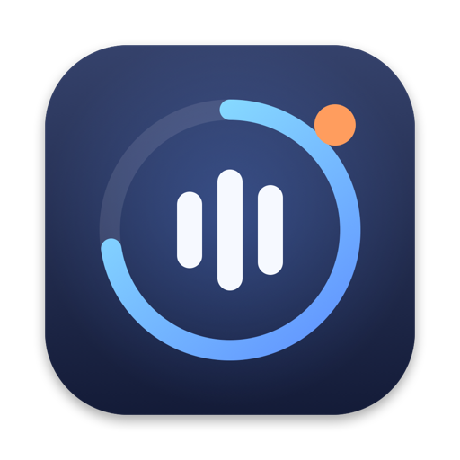
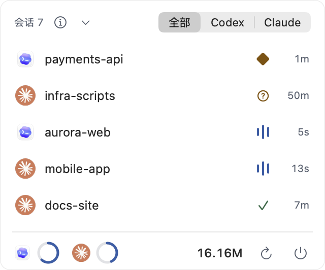
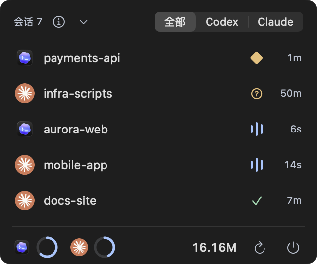
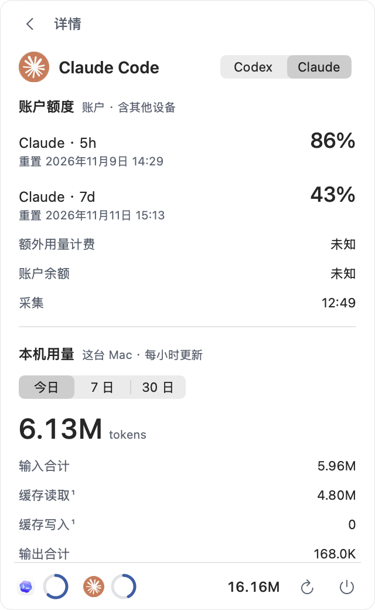
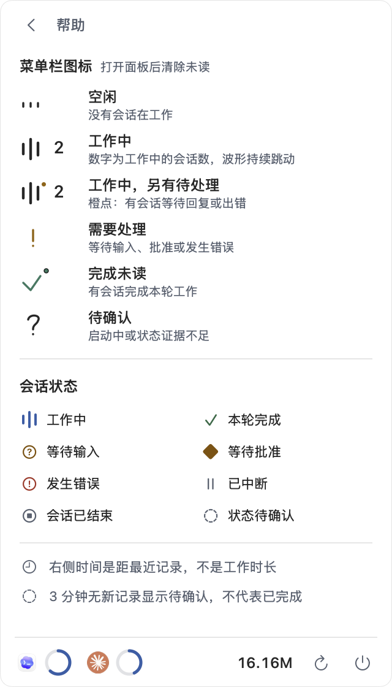
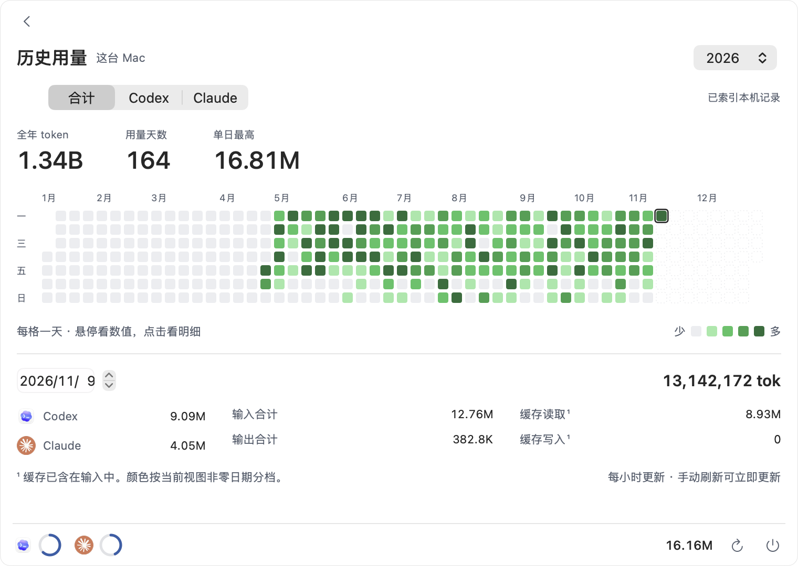

<p align="center">
  
</p>

<h1 align="center">a-watcher</h1>

<p align="center">
  住在菜单栏里的 AI 编程助手看板。<br>
  一眼看清 Codex 与 Claude Code 谁在干活、谁在等你、今天用了多少、额度还剩多少。
</p>

<p align="center">
  <a href="../../releases/latest">下载最新版本</a> · macOS 14+ · Apple Silicon
</p>

<p align="center">
  
  &nbsp;&nbsp;
  
</p>

## 为什么需要它

同时开着好几个 Agent 时，最常见的问题是：哪个还在跑？哪个卡在等我批准？额度会不会突然用完？
a-watcher 把这些答案收进菜单栏的一个小图标里，不用来回切窗口翻终端。

## 功能

**菜单栏实时状态**
有 Agent 在工作时，图标显示正在工作的会话数和一段持续的波形动效；全部完成后留下一个勾和未读点，打开面板即清除。

<p>
  
  &nbsp;工作中&nbsp;&nbsp;&nbsp;
  
  &nbsp;已完成
</p>

**一个面板看全部会话**
Codex 与 Claude Code 的近期会话按项目列出，状态一目了然：正在工作、等待批准、等待输入、本轮完成。可以按 Agent 筛选，点开查看详情。

**账户额度一眼可见**
面板底部用圆环显示每个 Agent 的 7 日剩余额度，悬停看精确数值；点开详情页，同一页查看 5 小时与 7 日窗口、重置时间和这台 Mac 的本机用量。菜单栏图标各形态的含义见面板里的帮助页。

<p align="center">
  
  &nbsp;&nbsp;
  
</p>

**今日用量与年度热力图**
底部数字是这台 Mac 今天两个 Agent 的 token 合计。点开即是全年热力图，可按天查看各 Agent 的用量明细。

<p align="center">
  
</p>

**轻、安静、省电**
原生 macOS 应用，不带额外的后台助手进程。开启"减少动态效果"、低电量或屏幕休眠时，动效自动静止。

**应用内更新**
从 0.7.0 开始，使用 Sparkle 每天自动检查新版本，确认后下载、验签、安装并重新打开应用。菜单栏图标右键菜单提供“检查更新…”和“自动检查更新”开关。更新清单与安装包来自 GitHub Releases，均须通过签名校验。旧版本需先手动安装一次带更新功能的版本。

## 安装

1. 在 [Releases](../../releases/latest) 下载 `a-watcher-*-macos-arm64.zip` 并解压。
2. 把 `a-watcher.app` 拖进"应用程序"文件夹。
3. 首次打开时，在应用上右键 → **打开**，或在"系统设置 → 隐私与安全性"中点**仍要打开**。当前版本尚未经过 Apple 公证。

打开后 a-watcher 只出现在菜单栏，没有 Dock 图标。左键打开面板；右键或面板右下角的电源按钮可退出。

使用前请确保 Codex 或 Claude Code 已经在这台 Mac 上登录过。

## 隐私

- 所有统计都在本机完成，不上传你的会话内容。
- 只读取 Agent 自己留下的本地记录和现有登录状态，不修改、不重新登录。
- 额度查询只发往各 Agent 的官方服务，用的是你已有的登录。
- 本地只保存统计结果，不保存聊天正文或登录凭据。
- 自动更新只向 GitHub 检查和下载应用更新，不携带 Agent 登录凭据或会话数据，不开启 Sparkle 系统信息统计。

## 从源码构建

```sh
bash Scripts/build.sh
open build/a-watcher.app
```

需要 Swift 6 工具链。更多开发说明见 [`docs/`](docs/)。
自动更新的密钥、签名与发布准备见 [自动更新说明](docs/dev/auto-update.md)。应用通过 SwiftPM 固定引入 Sparkle 2.10.1，其他运行依赖均为系统框架。
