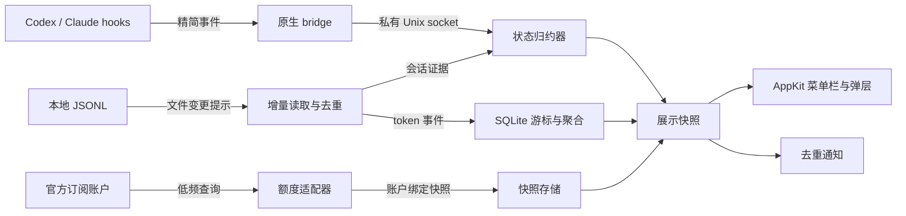

# 架构与数据口径

## 运行形态

一个常驻 GUI 进程，内部为模块化单体；一个按事件启动、发送后立即退出的 bridge。账户查询的 CLI helper 如确有必要，只在刷新期间存在，并把其峰值计入资源预算。

图示为本项目提案。文件事件只是“可能变化”的提示，仍需核对文件身份与偏移。FSEvents 会合并或丢失事件，因此要处理重扫标志和恢复：[Apple FSEvents 指南](https://developer.apple.com/library/archive/documentation/Darwin/Conceptual/FSEvents_ProgGuide/UsingtheFSEventsFramework/UsingtheFSEventsFramework.html)。

## 模块边界

- `WatcherCore`：领域模型、状态归约、token 归一化、价格计算、通知策略；可脱离 UI 测试。
- `WatcherSources`：Codex / Claude 日志、hook、额度、凭据和宿主定位适配。
- `WatcherStore`：sqlite3 游标、去重索引、聚合、历史覆盖范围。
- `WatcherApp`：AppKit 生命周期和 UI；后台工作不在主线程执行。
- `watcher-bridge`：白名单提取、限量 IPC、立即退出。只观察，不输出批准、拒绝或改变 Agent 行为的决策。

以上为目标职责边界。当前 Codex 首接入已实现于 `WatcherCore`（模型、解析、SQLite、文件事件、额度）、`WatcherApp`（AppKit / SwiftUI）、`WatcherCLI` 和开发用 `WatcherChecks` 四个 target；尚未单独拆分 Sources / Store 库。Claude 与 hook bridge 属于后续阶段，不会在当前应用后台接入。

## 状态与可信程度

会话主键为 provider + canonicalRoot + sessionID；子 Agent 独立建模并关联 parentSessionID。项目名只是标签，不是主键。

事件按会话归约：新输入进入运行；工具开始/结束细化活动；批准或输入等待有明确标记才进入相应状态；Stop 表示本轮结束，不等于会话退出；SessionEnd 表示会话结束。取消、中断、错误分别保留原因。

保存 `observedAt`、`source`、`confidence` 与会话代次。后台 hook 并行、延迟或乱序时，旧轮次事件不能覆盖新轮次；无轮次标识则用有限的冲突消解并降低可信程度。超时只标“状态待确认”，不能伪造错误或完成；长工具执行不因静默变空闲。启动恢复时从最近证据重建，不把旧 running 无条件续用。

Codex app-server 的状态通知仅在证明能订阅目标实例时使用；新启动一个 server 不构成对所有会话的监控。

## 增量日志读取

1. 只监控已配置的 Agent 根目录；启动先呈现缓存，再建立监听，按时间优先后台建索引。
2. 文件游标包含设备/inode、偏移、大小、mtime、解析版本；半行留到下一次读，遇到截断/替换重建该文件的派生数据。
3. 事件合并为一批，默认 250–500 ms 防抖；热文件可用 DispatchSource 辅助，watch 数量有上限。历史目录不秒级遍历。
4. 逐行读取，未知字段忽略；损坏行记录诊断，不阻断其他文件。超大单行有内存上限，跳过时标记统计不完整。
5. 首次索引、断点续扫、丢失事件恢复均有时间片和 IO 预算；休眠唤醒后核对监听与游标，不瞬间全量扫描。
6. 写入用事务成批完成，单个后台写者；游标与对应增量同事务提交，避免崩溃后重复入账。

## 统计准确性

**Codex**：区分累计总数与请求增量；同一累计快照重复出现不再入账；处理回退、恢复、fork/subagent 继承前缀与 compaction 独立 usage。不能只把最后的 session 总数全放到今天，也不能同时累加 `token_count` 和等价的 `token_usage_record`。

**Claude**：请求或消息标识与会话/来源共同去重；后来的完整流式记录修正早期计数，不能 first-write-wins；父会话复制和 sidechain 重放不能重复算，真正子 Agent 请求要保留。

以上风险来自对照 [ccusage Codex parser](https://github.com/ccusage/ccusage/blob/615bd802bc5c50246b84e98406f20ab048e27cf6/rust/adapters/codex/src/parser.rs) 与 [Claude daily](https://github.com/ccusage/ccusage/blob/615bd802bc5c50246b84e98406f20ab048e27cf6/rust/adapters/claude/src/daily.rs) 后形成的本项目测试要求。

### 统一 token 口径

| 维度 | Codex | Claude |
| --- | --- | --- |
| 输入合计 | `input_tokens` 已含缓存读取 | 通常需加 `input_tokens`、缓存读取、缓存创建 |
| 输出合计 | 含 reasoning 细分，不额外相加 | 以该记录 usage 的输出字段为准 |
| 缓存子项 | 读取、写入分别保留；按版本确认包含关系 | 总创建量与 TTL 细分不能重复相加 |
| 总 token | 统一为输入合计 + 输出合计 | 同左 |

合成例子：Codex 输入 1,000（其中缓存读 800），输出 200，总量为 1,200。Claude 普通输入 200、缓存读 800、缓存写 100、输出 200，总量为 1,300。推理只做细分展示。

费用使用有版本的价格快照和各计费桶，展示为 **API 等价估算**。模型、服务档位或价格缺失时金额为空或标“已定价小计”，不能显示零；不把订阅费按 token 伪摊销。日统计按事件时间与所选时区（初始跟随系统）分桶；缺失时间单独标记，不用 mtime 冒充请求时间。

## 额度、账户与刷新

`QuotaSnapshot` 包含 provider、accountBinding、source、capturedAt、windows、credits、freshness。窗口保存服务端 ID、时长、重置时间、已用百分比；剩余显示为有效百分比的补数。未知、无限额、空响应分别处理。接口未返回的窗口不补造。

建议活动时每 2 分钟刷新、无活动时 15 分钟、低电量时 30 分钟；打开弹层只在快照超过 60 秒时触发合并刷新。支持手动刷新与服务端 Retry-After，失败指数退避并加抖动。同一来源同一账户最多一个请求在途。

普通网络失败保留同账户旧快照及原采集时间；认证失败、来源改变、账户切换则停止将旧值作为当前额度展示。默认历史用量范围是“这台 Mac”；有可验证账户元数据才归属账户。额度跨设备、用量本机两个范围始终标明。

## 存储与权限

应用派生数据置于 `~/Library/Application Support/a-watcher/`；设置用 UserDefaults；SQLite 只保留必要的会话元数据、token 和索引，不复制提示词、回复或工具输出。

私有 socket 目录 0700、socket 0600，路径长度受限并验证对端用户；bridge 限制消息体大小、连接超时、并发与总存活时间。hook 原始 stdin 可能含敏感内容，只白名单提取后发送，不落原文。

接入提供可预览的最小配置补丁、备份、原子合并与精确卸载；不删第三方 hooks。Codex 信任由其原有 UI 完成。Keychain 按用户动作授权；后台失败不循环弹窗。不默认读取浏览器 cookies，不请求屏幕录制或辅助功能；需要终端自动化的跳转单独降级处理。

建议初期用直接分发的签名应用；是否 App Sandbox / App Store 会影响目录与凭据接入，须在分发决定时验证，不能先承诺商店上架。
